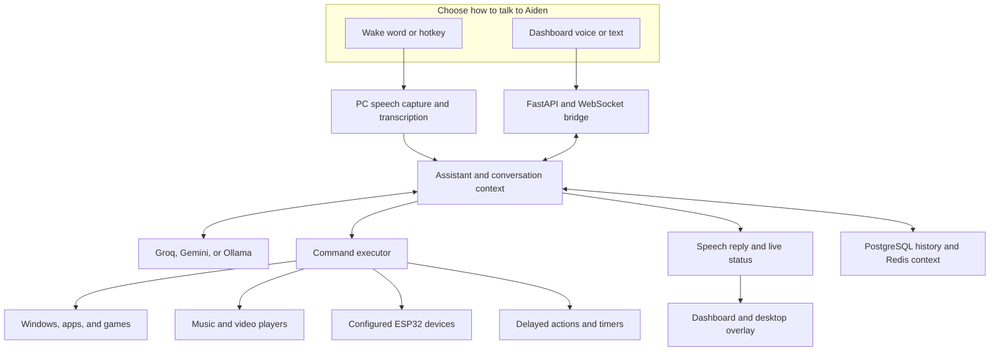
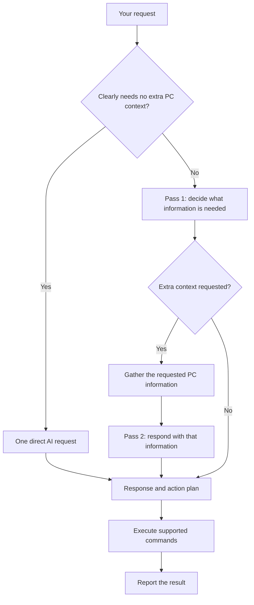

<div align="center">

# Aiden

### Your Windows PC, a conversation away.

Talk naturally. Open your apps. Control your music. Schedule an action.<br>
Keep the conversation going from your desktop or dashboard.


**Voice assistant · Desktop automation · Conversations · Media · Smart home**

[Get started](#get-started) · [How it works](#how-aiden-fits-together) · [Two-pass intelligence](#the-two-pass-system) · [Documentation](#explore-further)

</div>

---

## Meet Aiden

Aiden connects natural conversation to actions on your Windows computer. Speak through your PC microphone, use a hotkey, or type in the dashboard. Aiden interprets the request, runs supported commands, and reports the result.

A local wake-word listener, an AI conversation engine, and a command executor work together behind the scenes. The optional desktop overlay makes listening and replies visible without keeping a browser window open.

| Say something like… | What Aiden can do |
| --- | --- |
| “Open Notepad.” | Launch an installed application. |
| “Open my game.” | Use available app and Steam context to find a game; ask for detail when needed. |
| “Pause.” / “Next song.” / “Turn the volume up.” | Select supported current playback without requiring an app name. |
| “Play Friends on Jellyfin.” | Find a matching series and use available watch progress or episode information. |
| “Lock my PC in five minutes.” | Schedule an action you can view or cancel. |
| “Switch to headphones.” | Change supported Windows audio settings. |
| “Turn on the fan.” | Control your configured ESP32 device. |
| Ask a question, then a follow-up. | Keep conversational context instead of starting over. |

Examples depend on your configured integrations, available devices, and the information in your request.

## What makes it interesting

**It can look before it acts.** The two-pass system requests relevant context, such as installed apps or running processes, when the request needs it. Simple requests can take a faster route.

**The conversation can continue.** When Aiden asks a question, it can listen for your answer and carry context into the next turn. You can interrupt output and stop an active listen.

**It has a desktop presence.** The tray app, React dashboard, and optional Electron overlay show connection, listening, and response activity. WebSocket updates keep the interfaces in sync.

**Actions can happen later.** Delayed commands and timers have dashboard visibility and cancellation paths. Ask now and have a supported action run after a delay.

**Playback follows what you are using.** The media router checks Spotify, Jellyfin, and Windows browser media sessions. It remembers playback temporarily paused for listening and preserves a requested pause through follow-up turns. If the choice is ambiguous, it asks rather than choosing an arbitrary player.

**The voice path prepares before the cue.** CPU ONNX speech detection, microphone readiness checks, and a small background warm-up help reduce cold listening delays. They improve readiness without promising a fixed response time.

## How Aiden fits together



The **assistant** coordinates the conversation. The **AI provider** proposes a structured response and commands. The **executor** runs supported actions and reports their outcomes. The dashboard and overlay display the result.

### The two-pass system

A vague request often needs facts from your PC. Instead of supplying every piece of system information for every question, Aiden can first ask the model what context is relevant.

1. **Pass 1 — decide what is needed.** Aiden sends the request and conversation context. The model can request specific information, such as installed apps or running processes.
2. **Pass 2 — plan with that context.** If extra information is requested, Aiden gathers it and asks for a final response and action plan.
3. **Execute and report.** Supported commands run through the executor, and the reply uses their reported outcomes.



**Two-pass does not mean two model calls every time.** A local classifier can skip the context-selection pass for simple requests. A Pass 1 response that needs no extra context can also be used directly. Repair or fallback requests may add calls when a response is incomplete.

For example, opening an app may need the installed-app list; closing a vaguely named program may need running-process information. A general knowledge question usually does not need either. [Architecture guide →](docs/architecture.md)

## Get started

### 1. Install the prerequisites

| Requirement | Purpose |
| --- | --- |
| Windows | Desktop controls, tray app, and native media integration |
| Python 3.10+ | Assistant backend; Python 3.11 is recommended by the installer |
| Node.js 22.12+ | Dashboard and optional overlay builds |
| Git | Clone and update the project |
| A working microphone | PC voice input; typing also works |

Enable Python on PATH and reopen PowerShell after installing prerequisites.

### 2. Clone and install

```powershell
git clone https://github.com/SahiDemon/Aiden.git
cd Aiden
powershell -ExecutionPolicy Bypass -File .\install.ps1
```

The installer creates or reuses a Python environment, installs dependencies, downloads the default English Vosk model, creates `.env` if missing, and builds the dashboard. It preserves an existing `.env`.

To include the desktop overlay and development tools:

```powershell
powershell -ExecutionPolicy Bypass -File .\install.ps1 -IncludeOverlay -Dev
```

### 3. Add your service credentials

Edit your local `.env`. A minimal Groq-based setup uses:

```dotenv
LLM_PROVIDER=groq
GROQ_API_KEY=your-key
NEON_DATABASE_URL=your-postgresql-connection-string
REDIS_URL=your-redis-connection-string
```

The current configuration requires a configured LLM provider, PostgreSQL, and Redis. Groq is also used for PC speech transcription, including when another LLM provider is selected. [Provider and integration setup →](docs/configuration.md)

### 4. Launch and try it

```powershell
.\run_aiden.ps1 -Debug
```

Open **[localhost:5000](http://localhost:5000)** and try “What time is it?” or “Open Notepad.” Once setup works, launch with `.\run_aiden.ps1` for the background tray experience.

| Default control | Action |
| --- | --- |
| `Ctrl+Shift+Space` | Activate PC voice input |
| `Ctrl+.` | Toggle wake-word listening |
| `Ctrl+Shift+/` | Stop an active listen |
| Tray menu | Manage the running app |

Hotkeys can be changed in `.env`. Wake phrases depend on the selected engine and model; a custom openWakeWord “Aiden” model must be supplied separately. [Full setup guide →](docs/setup.md)

## Choose your integrations

| Integration | What it adds | Setup |
| --- | --- | --- |
| Groq / Gemini / Ollama | Cloud or local LLM responses | [Configuration](docs/configuration.md) |
| Vosk / Porcupine / openWakeWord | Local wake-word detection | [Microphone and activation](docs/configuration.md#microphone-and-activation) |
| Edge / Google / local TTS options | Spoken replies | [Configuration](docs/configuration.md), [Google voices](docs/guides/google-chirp-tts.md) |
| Spotify | Music search and playback control | `SPOTIFY_*` credentials |
| Jellyfin | Movie and series playback on connected sessions | `JELLYFIN_URL` and `JELLYFIN_API_KEY` |
| Chromium media sessions | Current browser playback controls on Windows | Installed Windows media dependencies and a browser that publishes media sessions |
| ESP32 | Smart-home controls and device state | Enable and configure your own device |
| UPS monitoring | Optional power alerts and shutdown behavior | [UPS guide](docs/guides/ups-monitoring.md) |
| Cloudflare Tunnel | Optional access from another device | [Security and remote access](SECURITY.md) |

### What stays local—and what needs the network

Wake-word detection, microphone capture, speech activity detection, and Windows actions run on your PC. PC command audio is sent to Groq for transcription. Cloud LLMs and cloud speech services require internet access; Ollama can provide local LLM responses. Dashboard device-microphone input uses the browser's speech-recognition support.

Credentials belong in `.env`, never in Git. The backend normally listens on localhost and does not provide its own authenticated-user boundary. Configure access protection before publishing it remotely. [Data flow and security →](SECURITY.md)

<details>
<summary><strong>Project map and development commands</strong></summary>

```text
Aiden/
├── src/                 Assistant, speech, AI, actions, API, media, and tray
├── dashboard/           React dashboard
├── overlay/             Electron + React desktop overlay
├── config/              Shared prompts and configuration assets
├── tests/               Backend regression tests
├── scripts/             Utilities and opt-in diagnostics
├── tools/               Optional local Windows helpers
└── docs/                Setup, architecture, and integration guides
```

```powershell
# Backend, including regression tests beside their modules
.\.venv\Scripts\python.exe -m pip install -r requirements-dev.txt
.\.venv\Scripts\python.exe -m pytest

# Dashboard
cd dashboard
npm ci
npm run dev
npm run test -- --watchAll=false
npm run build
```

If setup reused `venv`, substitute it for `.venv`. The overlay has its own [development guide](overlay/README.md).

Environments, model binaries, logs, caches, and generated builds stay local. Some opt-in diagnostics can change playback or Windows state; keep them separate from automated tests. [Contribution guide →](CONTRIBUTING.md)

</details>

## Explore further

| Guide | Start here when… |
| --- | --- |
| [Documentation index](docs/README.md) | You want the full map. |
| [Setup](docs/setup.md) | You are installing or updating Aiden. |
| [Configuration](docs/configuration.md) | You want another provider, microphone, or integration. |
| [Architecture](docs/architecture.md) | You want to understand the system and request lifecycle. |
| [Troubleshooting](docs/troubleshooting.md) | Something is not working as expected. |
| [Voice latency](docs/voice-latency.md) | You are investigating response timing. |
| [Security](SECURITY.md) | You are configuring credentials or remote access. |
| [Changelog](CHANGELOG.md) | You want the project history. |

---

<div align="center">

**Built around your Windows desktop, connected through conversation.**

`voice-assistant` · `windows-automation` · `two-pass-ai` · `react-dashboard` · `electron` · `smart-home`

</div>
