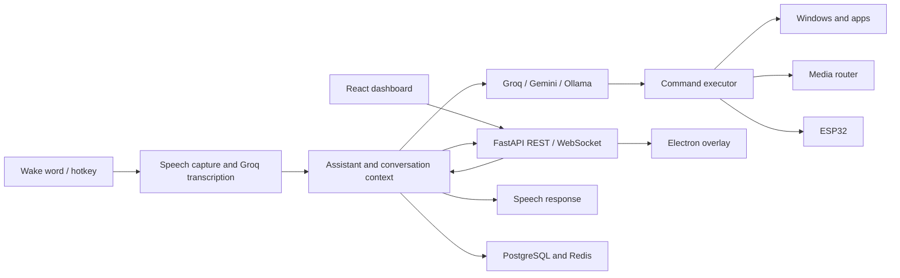

# Architecture

Aiden combines a Windows tray application and asynchronous Python backend with a React dashboard and optional Electron overlay.

## Module boundaries

| Location | Responsibility |
| --- | --- |
| `src/main.py` | Service startup/shutdown, tray wiring, hotkeys, wake activation, API lifecycle |
| `src/core/` | Assistant sessions, conversational context, follow-ups, and command coordination |
| `src/ai/` | Provider clients and model responses; Groq audio transcription |
| `src/speech/` | Microphone capture, VAD, wake-word engines, and TTS |
| `src/execution/` | Windows/app commands, delayed actions, and action routing |
| `src/media/` | Spotify/browser/Jellyfin controllers and playback restoration |
| `src/api/` | REST routes and WebSocket events consumed by both interfaces |
| `src/database/` | PostgreSQL models/persistence and Redis context/cache clients |
| `src/services/` | Settings, timers, and other application services |
| `src/smart_home/`, `smart_home/` | Device client integration and hardware assets |
| `src/utils/`, `src/tray/` | Paths, configuration, logging, runtime helpers, and tray UI |

## Request lifecycle

Activation opens a listening session and pauses supported active media. Speech capture waits for microphone readiness and voice activity, then sends the captured command to Groq for transcription. Typed messages enter through the API without audio capture. The assistant builds context, requests a structured provider response, and routes commands through the executor. It broadcasts state/messages to the dashboard and overlay, speaks the response when appropriate, and restores playback when the listening interaction ends.

The media router records which Jellyfin sessions it successfully paused. Restoration handles each session independently so one failed or disappeared session does not stop the others. Delayed commands and timers have explicit cancel paths and are shown in the dashboard.

## Configuration and prompts

`src/utils/config.py` validates `.env` and merges runtime overrides. `src/utils/paths.py` resolves resources for source and PyInstaller runs. `config/prompts.yaml` supplies defaults through the shared prompt loader; it caches defaults, invalidates on file changes, returns independent copies, and applies runtime overrides.

## Persistence and interfaces

PostgreSQL stores conversations, commands, preferences, and scheduled timers. Redis supports conversation context and caches. Required connection strings are checked at startup; outage recovery varies by client and feature.

FastAPI serves `dashboard/build` and exposes the WebSocket endpoint at `/api/v1/ws`. The source overlay connects to `ws://localhost:5000/api/v1/ws`. UI code stays in `dashboard` and `overlay`; generated bundles remain local.

## Runtime and security boundaries

The backend normally binds to `localhost:5000`. Its command execution capabilities inherit the Windows user’s permissions. Cloudflare Tunnel may publish a protected hostname, but Access policies, MFA, and tunnel-side token validation must be configured independently. The backend does not provide its own authenticated-user boundary. [Security details →](../SECURITY.md)

The Guardian launcher can restart the app. Use the tray/stop workflow for intentional shutdown. Live hardware and audio behavior requires manual validation beyond the mock-based regression suite.
